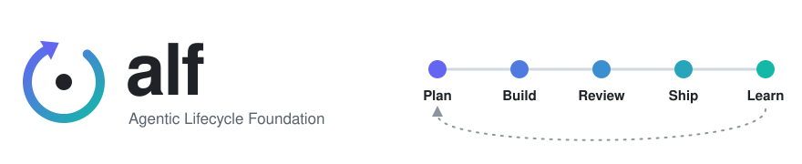
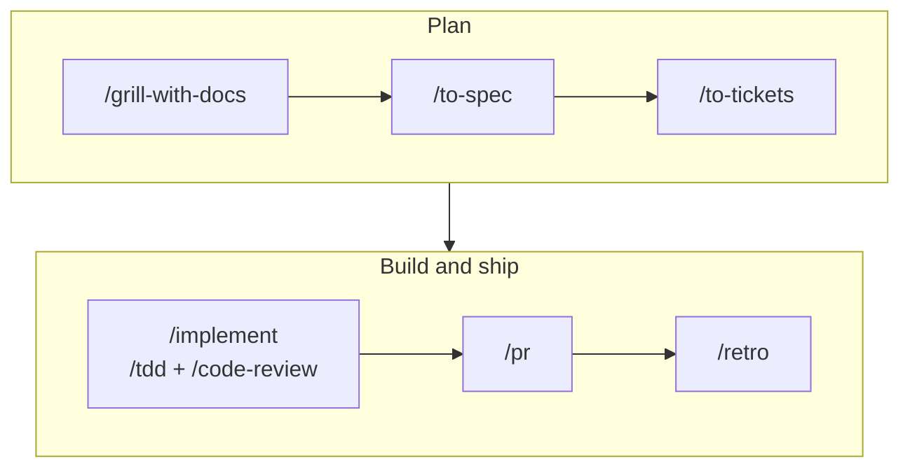
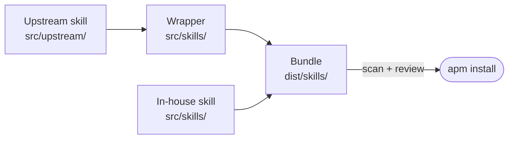

<div align="center">

<h1></h1>

**A sound base of agent skills for the core of the software development lifecycle.**<br>
Install it into Claude Code or GitHub Copilot through [APM](https://microsoft.github.io/apm/), and your team starts from the same skills.

[](https://github.com/dev-soprasteriano/alf/actions/workflows/ci.yml)
[](LICENSE)

[Install](#install) · [First run](#first-run) · [Main flow](#main-flow) · [Skills](#skills) · [Update](#update) · [Maintain](docs/maintainers.md)

</div>

- **Built for the full development lifecycle.** Start a project, plan it, build it, fix it, review it and ship it, with skills for each step.
- **Reviewed and scanned.** Each skill records its upstream commit. Every change passes a security scan and a human review.
- **You control updates.** Pin a commit, and the team runs the same skills until someone moves the pin.
- **Flexible.** Install every skill from one manifest, or only the skills you need.

## Install

Install APM first: `brew install apm`.

**Every skill.** Copy the manifest and install it:

```sh
mkdir -p ~/.apm
curl -fsSL -o ~/.apm/apm.yml https://raw.githubusercontent.com/dev-soprasteriano/alf/main/dist/user-apm.yml
apm install -g
```

**Only some skills.** Write your own `apm.yml` and run `apm install`. Commit it to share the set with your team:

```yaml
targets:
  - claude
  - copilot
dependencies:
  apm:
    - dev-soprasteriano/alf/dist/skills/grill-with-docs
```

A skill also installs the skills it calls by name:

```text
grill-with-docs
├── grilling
└── domain-modeling
```

**Pin a set.** Add `#<commit sha>` to every entry, including the skills it calls. A called skill without a pin comes from the default branch.

**Turn off a skill.** Delete its line from your `apm.yml`, then run `apm install`. For the global file at `~/.apm/apm.yml`, run `apm install -g`.

## First run

Type `/<skill>` to run a skill. Run `/setup-alf` once in each repo, before the other skills. It asks about your issue tracker, triage labels and domain docs, then writes:

```text
AGENTS.md                # an "Agent skills" block that points at the files below
docs/agents/
├── issue-tracker.md     # where issues live and how to reach them
├── triage-labels.md     # the label for each triage role, when triage is installed
└── domain.md            # where the glossary and ADRs live
```

The other skills read these files.

## Main flow

Take an idea to ship:



Work that fits in one session skips `/to-spec` and `/to-tickets`.

Other starting points:

| Starting from | Run |
| --- | --- |
| Incoming issues | `/triage` |
| A hard bug | `/diagnosing-bugs` |
| An effort too big for one session | `/wayfinder`, then `/to-spec` |

Not sure which skill fits? Run `/ask-alf`.

## Skills

<!-- readme:skills start -->

### Software development lifecycle

| Stage | Skills |
| --- | --- |
| Plan | `grill-with-docs`, `grill-me`, `grilling`, `to-spec`, `to-tickets`, `wayfinder` |
| Build | `implement`, `implement-spec`, `tdd`, `prototype` |
| Fix a bug | `diagnosing-bugs`, `tdd` |
| Review and ship | `code-review`, `pr`, `git-commit`, `triage` |
| Design and architecture | `improve-codebase-architecture`, `codebase-design`, `domain-modeling` |
| Research and learn | `research`, `teach`, `show-me` |

### Meta skills

| Purpose | Skills |
| --- | --- |
| Set up | `setup-alf`, `repo-doctor`, `ci-doctor`, `wizard` for steps only a person can do |
| Find your way | `ask-alf` |
| Work better with agents | `retro`, `writing-for-agents`, `wait-what` |
| Hand over and ask | `handoff`, `to-questionnaire` |

<!-- readme:skills end -->

`dist/user-apm.yml` lists every skill.

The agent also starts these skills by itself when a task fits. Every other skill runs only when you type it.

<!-- readme:agent-started start -->

`code-review`, `codebase-design`, `diagnosing-bugs`, `domain-modeling`, `git-commit`, `grilling`, `pr`, `prototype`, `research`, `tdd`, `wizard`, `writing-for-agents`

<!-- readme:agent-started end -->

## How a skill reaches you



Wrapped skills come from two upstreams:

| Upstream | Skills | License |
| --- | --- | --- |
| [mattpocock/skills](https://github.com/mattpocock/skills) | All wrapped skills except `show-me` | MIT, © 2026 Matt Pocock |
| [humanlayer/skills](https://github.com/humanlayer/skills) | `show-me` | MIT, © 2026 HumanLayer |

These skills are in-house:

<!-- readme:in-house start -->

`ci-doctor`, `git-commit`, `repo-doctor`

<!-- readme:in-house end -->

Each `src/upstream/<upstream>/PIN.md` records the commit of every upstream skill. [GLOSSARY.md](GLOSSARY.md) defines each term.

## Update

Skills follow the default branch unless you pin them. Run `apm update -g` for one user, or `apm update` for a team, to move to the newest commit. Pin a commit to keep a skill fixed until you change the pin.

## Maintainers

If you wish to contribute, read [docs/maintainers.md](docs/maintainers.md).

## License

MIT. See [LICENSE](LICENSE).

Some skills are provided by third parties under their own licenses. See [NOTICE.md](NOTICE.md) for the full license attribution.
