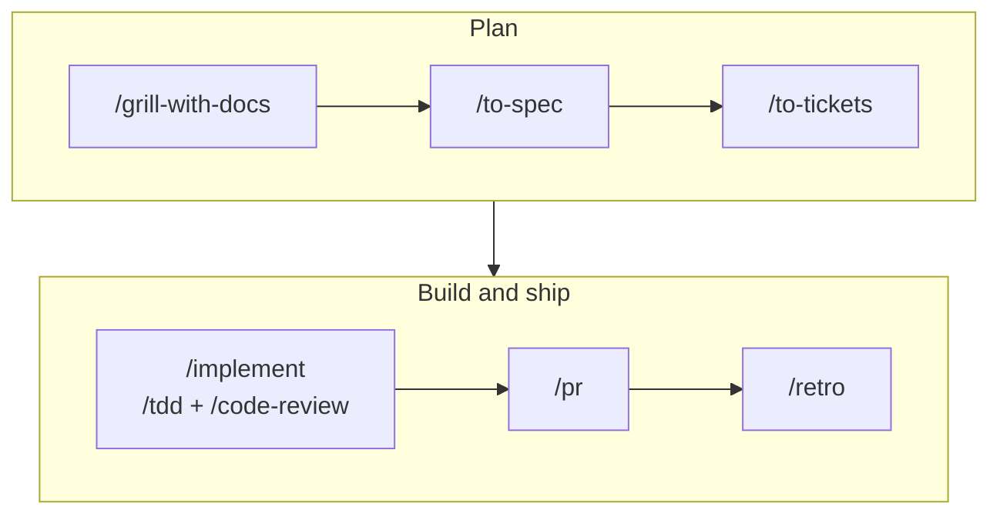

<div align="center">

<h1></h1>

**A sound base of agent skills for the core of the software development lifecycle.**<br>
Install it into Claude Code or GitHub Copilot through [APM](https://microsoft.github.io/apm/), and your team starts from the same skills.

[](https://github.com/dev-soprasteriano/alf/actions/workflows/ci.yml)
[](LICENSE)

[Install](#install) · [Main flow](#main-flow) · [Skills](#skills) · [Update](#update) · [Maintain](docs/maintainers.md)

</div>

- **Built for the full development lifecycle.** Start a project, plan it, build it, fix it, review it and ship it, with skills for each step.
- **Reviewed and scanned.** Each skill records its upstream commit. Every change passes a security scan and a human review.
- **You control updates.** Pin a commit, and the team runs the same skills until someone moves the pin.
- **Flexible.** Install every skill from one manifest, or only the skills you need.

## Install

Install APM first: `brew install apm`.

**Every skill.** Copy the manifest and install it:

```sh
mkdir -p ~/.apm
curl -fsSL -o ~/.apm/apm.yml https://raw.githubusercontent.com/dev-soprasteriano/alf/main/dist/user-apm.yml
apm install -g
```

**Only some skills.** Write your own `apm.yml` and run `apm install`. Commit it to share the set with your team:

```yaml
targets:
  - claude
  - copilot
dependencies:
  apm:
    - dev-soprasteriano/alf/dist/skills/grill-with-docs
```

A skill also installs the skills it calls by name:

```text
grill-with-docs
├── grilling
└── domain-modeling
```

**Pin a set.** Add `#<commit sha>` to every entry, including the skills it calls. A called skill without a pin comes from the default branch.

**Turn off a skill.** Delete its line from your `apm.yml`, then run `apm install`. For the global file at `~/.apm/apm.yml`, run `apm install -g`.

## Main flow

Run `/setup-alf` once in a new repo. Then take an idea to ship:



Work that fits in one session skips `/to-spec` and `/to-tickets`.

Three on-ramps join the flow:

| Starting from | Run | Then |
| --- | --- | --- |
| Incoming issues | `/triage` | `/implement` |
| A hard bug | `/diagnosing-bugs` | `/retro` |
| An effort too big for one session | `/wayfinder` | `/to-spec` |

Not sure which skill fits? Run `/ask-alf`.

## Skills

| Need | Skills |
| --- | --- |
| Set up a repo | `setup-alf`, `repo-doctor`, `ci-doctor`, `wizard` for steps only a person can do |
| Plan | `grill-with-docs`, `grill-me`, `grilling`, `to-spec`, `to-tickets`, `wayfinder` |
| Build | `implement`, `implement-spec`, `tdd`, `prototype` |
| Fix a bug | `diagnosing-bugs`, `tdd` |
| Review and ship | `code-review`, `pr`, `git-commit`, `triage` |
| Improve the architecture | `improve-codebase-architecture`, `codebase-design`, `domain-modeling` |
| Research and learn | `research`, `teach`, `show-me` |
| Improve how you work with agents | `retro`, `writing-for-agents` |
| Find your way | `ask-alf` |
| Other | `handoff`, `to-questionnaire`, `wait-what` |

`dist/user-apm.yml` lists every skill.

## How a skill reaches you


[GLOSSARY.md](GLOSSARY.md) defines each term.

## Update

Skills follow the default branch unless you pin them. Run `apm update -g` for one user, or `apm update` for a team, to move to the newest commit. Pin a commit to keep a skill fixed until you change the pin.

## Maintainers

If you wish to contribute, read [docs/maintainers.md](docs/maintainers.md).

## License

MIT. See [LICENSE](LICENSE). Each upstream folder keeps its own LICENSE.
