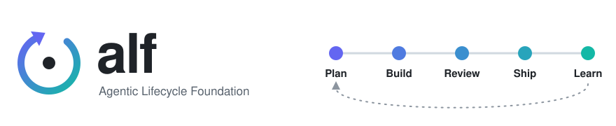
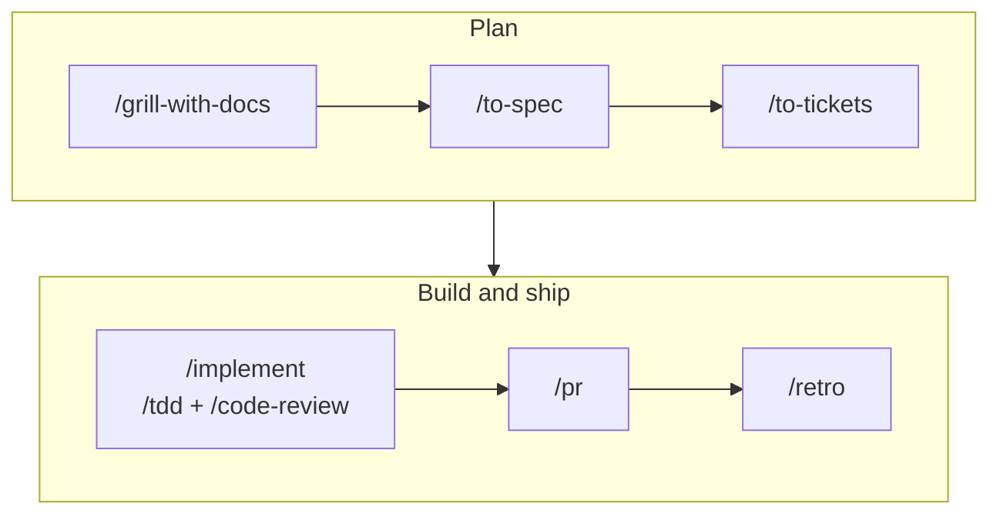
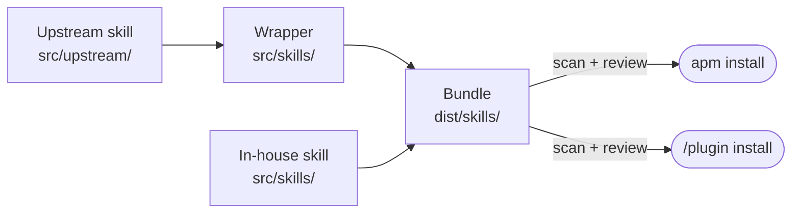

<div align="center">

<h1></h1>

**A sound base of agent skills for the core of the software development lifecycle.**<br>
Install it through [APM](https://microsoft.github.io/apm/) across coding agents, or as a plugin for Claude Code and GitHub Copilot, and your team starts from the same skills.

[](https://github.com/dev-soprasteriano/alf/actions/workflows/ci.yml)
[](LICENSE)

[Install](#install) · [First run](#first-run) · [Main flow](#main-flow) · [Skills](#skills) · [Update](#update) · [Maintain](docs/maintainers.md)

</div>

- **Built for the full development lifecycle.** Start a project, plan it, build it, fix it, review it and ship it, with skills for each step.
- **Reviewed and scanned.** Each skill records its upstream commit. Every change passes a security scan and a human review.
- **You control updates.** Pin a commit, and the team runs the same skills until someone moves the pin.
- **Flexible.** The plugin installs every skill. APM installs every skill or only the ones you pick.

## Install

### With APM

Install APM first: `brew install apm`.

**Every skill (user-wide).** Copy the manifest and install it:

```sh
mkdir -p ~/.apm
curl -fsSL -o ~/.apm/apm.yml https://raw.githubusercontent.com/dev-soprasteriano/alf/main/dist/user-apm.yml
apm install -g
```

`dist/user-apm.yml` deploys to the four user-scope skill roots: `agent-skills` (`~/.agents/skills/`, read by Copilot, Codex, Cursor, Gemini CLI and Windsurf), `claude` (`~/.claude/skills/`), `antigravity`, and `opencode` (`~/.config/opencode/skills/`). Remove any target you do not use (or drop `antigravity` if `~/.gemini/config/skills` symlinks to `~/.agents/skills`).

**In a project.** Write `apm.yml` and run `apm install`. Commit `apm.yml` and `apm.lock.yaml` (and optionally the deployed skills folder) to share the set with your team:

```yaml
targets:
  - agent-skills
  - claude
dependencies:
  apm:
    - dev-soprasteriano/alf/dist/skills/grill-with-docs
```

`agent-skills` writes `.agents/skills/`, which Copilot, Codex, Cursor, Gemini CLI, Antigravity, OpenCode and Windsurf read. Leave out `claude` if `.claude/skills` already symlinks to `.agents/skills`. To install every skill in one entry, depend on `dev-soprasteriano/alf/dist`.

A skill also installs the skills it calls by name:

```text
grill-with-docs
├── grilling
└── domain-modeling
```

**Pin a set.** Add `#<commit sha>` to every entry, including the skills it calls. A called skill without a pin comes from the default branch.

**Turn off a skill.** Delete its line from your `apm.yml`, then run `apm install`. For the global file at `~/.apm/apm.yml`, run `apm install -g`.

### As a plugin

The plugin installs every skill.

**Claude Code.** Run these in a session. `/plugin install` opens the plugin's details, where you choose a scope:

```text
/plugin marketplace add dev-soprasteriano/alf
/plugin install alf@alf
```

**Copilot CLI.** Run these in your shell:

```sh
copilot plugin marketplace add dev-soprasteriano/alf
copilot plugin install alf@alf
```

**Team.** Run both lines in the repo, then commit `.claude/settings.json`. Each teammate runs both lines once in their clone:

```sh
claude plugin marketplace add dev-soprasteriano/alf --scope project
claude plugin install alf@alf --scope project
```

**Pin.** Add `#<commit sha>` to the marketplace source: `/plugin marketplace add dev-soprasteriano/alf#<commit sha>`. To move the pin, remove the marketplace, add it again with the new SHA, and install the plugin again.

**Pick one channel.** With both APM and the plugin, Claude Code loads every skill twice, once as `alf:<skill>`. Copilot CLI keeps the APM copy and ignores the plugin copy, so the plugin never updates.

## First run

Type `/<skill>` to run a skill. Run `/setup-alf` once in each repo, before the other skills. It asks about your issue tracker, triage labels and domain docs, then writes:

```text
AGENTS.md                # an "Agent skills" block that points at the files below
docs/agents/
├── issue-tracker.md     # where issues live and how to reach them
├── triage-labels.md     # the label for each triage role, when triage is installed
└── domain.md            # where the glossary and ADRs live
```

The other skills read these files.

## Main flow

Take an idea to ship:



Work that fits in one session skips `/to-spec` and `/to-tickets`.

Other starting points:

| Starting from | Run |
| --- | --- |
| Incoming issues | `/triage` |
| A hard bug | `/diagnosing-bugs` |
| An effort too big for one session | `/wayfinder`, then `/to-spec` |

Not sure which skill fits? Run `/ask-alf`.

## Skills

<!-- skills:start -->

### Software development lifecycle

| Stage | Skills |
| --- | --- |
| Plan | `grill-with-docs`, `grill-me`, `grilling`, `to-spec`, `to-tickets`, `wayfinder` |
| Build | `implement`, `implement-spec`, `tdd`, `prototype` |
| Fix a bug | `diagnosing-bugs`, `tdd` |
| Review and ship | `code-review`, `pr`, `git-commit`, `triage` |
| Design and architecture | `improve-codebase-architecture`, `codebase-design`, `domain-modeling` |
| Research and learn | `research`, `teach`, `show-me` |

### Meta skills

| Purpose | Skills |
| --- | --- |
| Set up | `setup-alf`, `repo-doctor`, `ci-doctor`, `wizard` for steps only a person can do |
| Find your way | `ask-alf` |
| Work better with agents | `retro`, `writing-for-agents`, `wait-what` |
| Hand over and ask | `handoff`, `to-questionnaire` |

<!-- skills:end -->

`dist/user-apm.yml` lists every skill. [docs/harness-equivalents.md](docs/harness-equivalents.md) says when to run a skill and when to run a built-in command of Claude Code or Copilot CLI. [docs/agent-instructions.md](docs/agent-instructions.md) lists the rules that belong in your repo's instruction file, such as the commit message format.

A skill whose `SKILL.md` sets `disable-model-invocation: true` runs only when you type it. The agent also starts the other skills by itself when a task fits.

## How a skill reaches you



Wrapped skills come from two upstreams:

| Upstream | Skills | License |
| --- | --- | --- |
| [mattpocock/skills](https://github.com/mattpocock/skills) | All wrapped skills except `show-me` | MIT, © 2026 Matt Pocock |
| [humanlayer/skills](https://github.com/humanlayer/skills) | `show-me` | MIT, © 2026 HumanLayer |

[NOTICE.md](NOTICE.md) lists the skills from each upstream and the in-house skills. Each `src/upstream/<upstream>/PIN.md` records the commit of every upstream skill. [GLOSSARY.md](GLOSSARY.md) defines each term.

## Update

**APM.** Skills follow the default branch unless you pin them. Run `apm update -g` for one user, or `apm update` for a team, to move to the newest commit. Pin a commit to keep a skill fixed until you change the pin.

**Plugin in Claude Code.** Refresh the marketplace, then update the plugin:

```sh
claude plugin marketplace update alf
claude plugin update alf@alf
```

Or turn on auto-update: run `/plugin`, open the **Marketplaces** tab, select `alf`, and choose **Enable auto-update**.

**Plugin in Copilot CLI.** Refresh the marketplace, then update the plugin:

```sh
copilot plugin marketplace update alf
copilot plugin update alf
```

## Maintainers

If you wish to contribute, read [docs/maintainers.md](docs/maintainers.md).

## License

MIT. See [LICENSE](LICENSE).

Some skills are provided by third parties under their own licenses. See [NOTICE.md](NOTICE.md) for the full license attribution.
