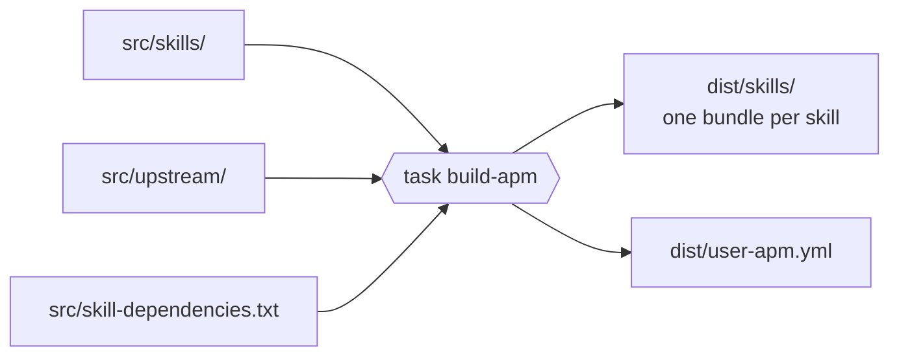
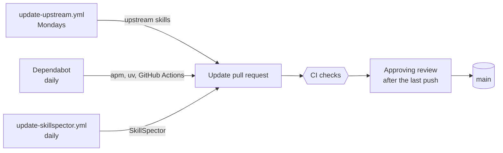

# Maintaining alf

For people who change this repo. To use the skills, read the [README](../README.md). Editing rules and the license check are in [AGENTS.md](../AGENTS.md).

## Layout

```text
src/
├── skills/                  # in-house skills and wrappers: edit here
├── upstream/                # copies of upstream skills: change with scripts/update-upstream.sh
└── skill-dependencies.txt   # the skills each skill calls or mentions
dist/                        # generated bundles: never edit
tools/                       # CI tools, pinned with hashes
scripts/                     # build, update and CI scripts
```

## Set up a clone

```sh
brew install go-task jq python@3.12
task hooks:install
```

Run `task --list` for the commands and their options. Once hooks are installed, each commit runs `task ci:staged`. `task ci` runs the full set that CI runs.

## Build after a change



After any change under `src/`, run `task build-apm` and commit `dist/` with it. `task ci` fails when `dist/` is stale.

## Change a skill

| To | Do |
| --- | --- |
| Add an in-house skill | Create `src/skills/<name>/SKILL.md` with `name` and `description` in its frontmatter. |
| Add an upstream skill | Run `scripts/update-upstream.sh add <upstream> <url> <path>[=<wrapper>]`. |
| Extend an upstream skill | Add instructions to the wrapper's `SKILL.md`, between `<!-- overlay:start -->` and `<!-- overlay:end -->`. |
| Pin an upstream skill | Run `task update-upstream SKILL=<name> REF=<sha or tag>`. |
| Move a pinned skill to latest | Run `task update-upstream SKILL=<name>`. |

Then build and commit.

- **README.** `task build-apm` fails when `README.md` differs from `src/`, and names the difference. [AGENTS.md](../AGENTS.md) lists the rules.
- **Dependencies.** If a skill calls or names other skills, list them in `src/skill-dependencies.txt`. The build fails on any unlisted name.
- **Add an upstream skill.** `<path>` is the skill folder in the upstream repo. `=<wrapper>` sets the wrapper name when it differs from the folder name. The script stops if the upstream has no LICENSE on its default branch. Check the skill's LICENSE and linked skills, as [AGENTS.md](../AGENTS.md) describes. Add any missing skill the same way.
- **Extend.** The update script keeps the overlay. For an example, see `src/skills/ask-alf/SKILL.md`.

## Updates

Three sources open update pull requests. Each one passes the same gate.



### Upstream skills

`.github/workflows/update-upstream.yml` runs `scripts/update-upstream.sh update` every Monday. It pushes `upstream/weekly-update` and opens or updates its pull request. It skips pinned skills. To run it now, start the workflow by hand from the Actions tab.

### CI tools

Each CI tool has a folder under `tools/`:

```text
tools/<tool>/
├── requirements.in    # pins the tool's version
└── requirements.txt   # pins every dependency with its hash
```

CI installs from `requirements.txt` and refuses any file whose hash does not match.

Dependabot opens the pull requests for apm, uv and the GitHub Actions, as `.github/dependabot.yml` sets. SkillSpector is not on PyPI, so `.github/workflows/update-skillspector.yml` opens its pull request.

The SkillSpector pull request carries over each accepted finding that the new version reports unchanged, with its reason. Only a finding the new version reports differently, or a new finding, fails the check. Accept those as [docs/skillspector.md](skillspector.md) describes, and push the baseline change to the update branch.

## Review an update pull request

1. For an upstream skill update, check the LICENSE and linked skills, as [AGENTS.md](../AGENTS.md) describes.
2. Wait for the CI checks. A failing check links to how to fix or accept its findings.
3. Approve after the last push. The branch rule below requires it.

| CI check | Fails when | Fix |
| --- | --- | --- |
| `build` | `dist/` is stale, `README.md` differs from `src/`, or a script test fails | Run `task build-apm`, fix what it reports, and commit. |
| `skillspector` | A skill has an active MEDIUM, HIGH or CRITICAL finding | [docs/skillspector.md](skillspector.md) |
| `apm-audit` | A file in `dist/` has hidden Unicode at WARNING or CRITICAL | [docs/apm-audit.md](apm-audit.md) |

## Branch rule

`main` requires the CI checks to pass and one approving review, given after the last push. GitHub's repository settings hold this rule, not the repo. Check it again after a fork or a recreation of the repo.
