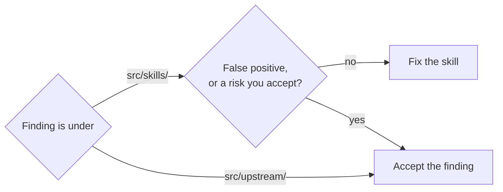

# SkillSpector checks

`task ci` scans every skill under `src/skills/` and `src/upstream/` with SkillSpector and fails on any active MEDIUM, HIGH, or CRITICAL finding. CI runs the same scan on every pull request.

When the check fails, read the log. Each line names the skill, the severity, the rule ID, and the file and line.

## Where the scan runs

| Command | Runs | Scans |
| --- | --- | --- |
| `task ci:staged` | On each commit, through the pre-commit hook. It checks `dist/` and runs the scope tests first. | The skill folders of the staged files, and each wrapper that links to a changed upstream skill. Every skill when the staged files change `.skillspector-baseline.yaml` or `tools/skillspector/requirements.txt`. |
| `task ci` | By hand. CI runs the same scan on every pull request. | Every skill. |

## Fix or accept



Don't edit files under `src/upstream/`. They are upstream copies.

## Accept a finding

1. Read the flagged line. Decide whether the finding is a false positive or a risk you accept.
2. Generate candidate entries outside the repo. Run this from the repo root:

   ```sh
   sh scripts/install-tools.sh skillspector
   .tools/skillspector/bin/skillspector baseline <skill-dir> -o <file-outside-repo> --no-llm --reason "<why it is safe>"
   ```

   `<skill-dir>` is the skill folder, such as `src/upstream/mattpocock/to-tickets`.
3. Open the output file. Copy only the entry whose `rule_id` and `file` match the finding into `.skillspector-baseline.yaml`. Set its `reason` to one or two sentences that say why the finding is safe.
4. Commit the baseline change with your pull request. The pre-commit hook runs `task ci:staged` and stops the commit while the finding is still active.

The generated file lists every finding in the skill. Copy only the entries you accept.

## When an accepted finding returns

Each entry is tied to the SkillSpector version pinned in `tools/skillspector/requirements.in` and to the exact file contents. An edit to the file makes the finding active again. Repeat steps 2 to 4.

The pull request that updates SkillSpector carries each entry over to the new version, with its reason, when the new version reports the finding unchanged. It lists the entries it drops. Repeat the steps for those, and for any new finding.

## Reviewer checklist

- [ ] The `reason` says why the finding is safe, in one or two sentences.
- [ ] The `rule_id` and `file` match the finding in the failing log.
- [ ] The pull request adds no entry for a finding the author did not show.
